<div align="center">

# Matematik Lab

**Matematiği dokunarak öğren.**
Lise (YKS) ve üniversite için 20 etkileşimli matematik simülasyonu: önce tahmin et, sonra gözlemle, ardından görevi kendin kur.

[](https://github.com/EthYusuf/matematik-lab/actions/workflows/ci.yml)


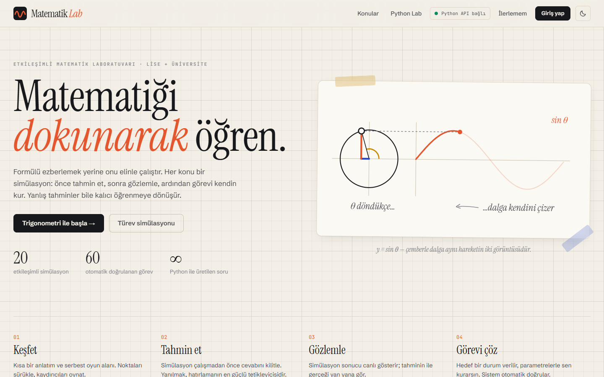

</div>

---

## Neden?

Öğrenciler türevi, integrali, Fourier serisini çoğu zaman **formül** olarak ezberler ama **ne yaptığını** görmez. Matematik Lab her konuyu elle oynanabilir bir simülasyona çevirir ve bilişsel bilimde iyi bilinen üç ilkeyi birleştirir:

| İlke | Uygulamadaki karşılığı |
|---|---|
| **Tahmin et → Gözlemle → Açıkla** (POE) | Simülasyon çalışmadan önce öğrenci cevabını kilitler. Yanlış tahmin "Beklenmedik bir sonuç!" ile işaretlenir; şaşırma anı kalıcı öğrenmeyi tetikler. |
| **Aktif öğrenme** | Her konuda 3 görev: hedef bir durum verilir (ör. *"Periyodu π, genliği 2 olan dalgayı kur"*), öğrenci parametrelerle kurar, sistem otomatik doğrular. |
| **Aralıklı tekrar** (SM-2) | Quiz'de cevaplanan konular 1 → 3 → 8 → 20 gün aralıklarla yeniden sorulur; yanlış cevaplananlar ertesi gün geri gelir. |

## Öne çıkanlar

- **20 simülasyon**, her birinde 4–5 adımlık ders, 3 otomatik doğrulanan görev, canlı formül (KaTeX) ve ölçüm paneli
- **Python backend'i (FastAPI + SymPy)**
  - Türev, integral ve limit için **adım adım çözüm** (çarpım/bölüm/zincir kuralı, kısmi integrasyon, L'Hôpital…). Her sonuç SymPy ile doğrulanır.
  - 20 konunun hepsi için **parametrik soru üretici**: her "Yeni soru" farklı sayılarla gelir. Cevap tarayıcıya gönderilmez, sunucuda aynı tohumla yeniden üretilip kontrol edilir.
- **Python Lab**: tarayıcıda gerçek Python (Pyodide/WebAssembly). NumPy, Matplotlib ve SymPy hazır; 10 hazır deney (Monte Carlo ile π, Newton-Raphson, merkezi limit teoremi…).
- **Hesaplar ve ilerleme**: kayıt/giriş, cihazlar arası ilerleme senkronu, ustalık haritası, 8 rozet, aralıklı tekrar kuyruğu
- **Gizlilik (KVKK)**: e-posta istenmez; yalnızca kullanıcı adı ve Argon2 parola özeti saklanır. "Hesabımı sil" düğmesi tüm verileri tek tıkla kalıcı olarak siler.
- **İki tema**: *Defter* (milimetrik kâğıt) ve *Kara Tahta*. Mobil uyumlu ve erişilebilir: ekran okuyucular için MathML, klavye ile kullanılabilir kontroller, hareket azaltma desteği.
- **Kütüphanesiz 3B**: çok değişkenli calculus için kendi yazılmış, gölgeli ve sürükleyerek döndürülebilen yüzey çizici; eş yükselti çizgileri marching squares ile.

## Ekran görüntüleri

<table>
  <tr>
    <td width="50%">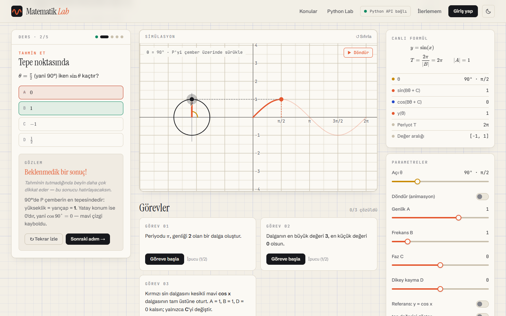<br/><sub><b>Tahmin et → gözlemle.</b> Yanlış tahmin işaretlenir, simülasyon doğru cevabı canlandırır.</sub></td>
    <td width="50%">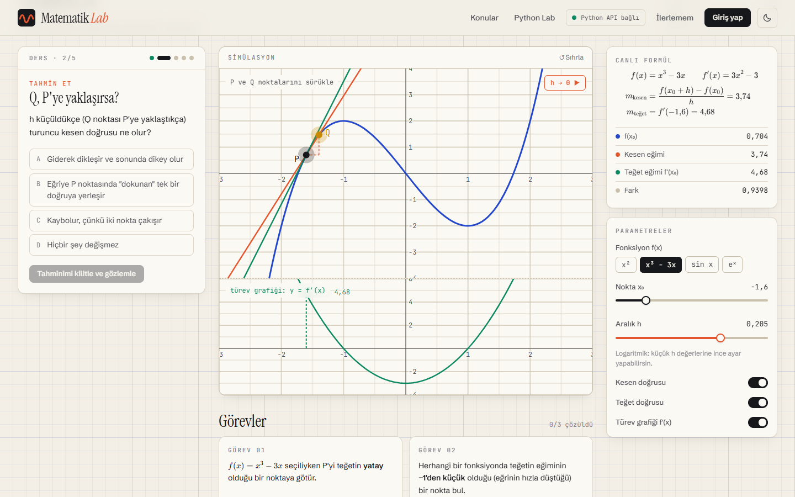<br/><sub><b>Türev.</b> Kesen doğrusu teğete dönüşür; alttaki türev grafiği üstteki eğimle hizalıdır.</sub></td>
  </tr>
  <tr>
    <td>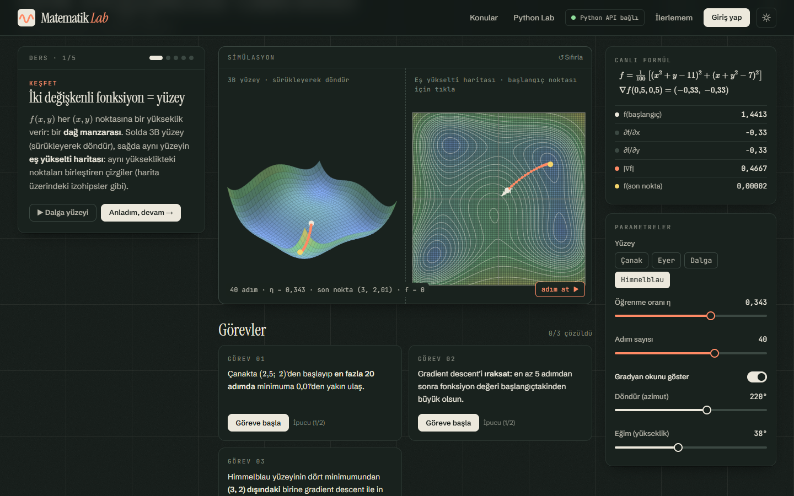<br/><sub><b>Çok değişkenli calculus.</b> 3B yüzey, eş yükselti haritası ve Himmelblau üzerinde gradient descent (Kara Tahta teması).</sub></td>
    <td>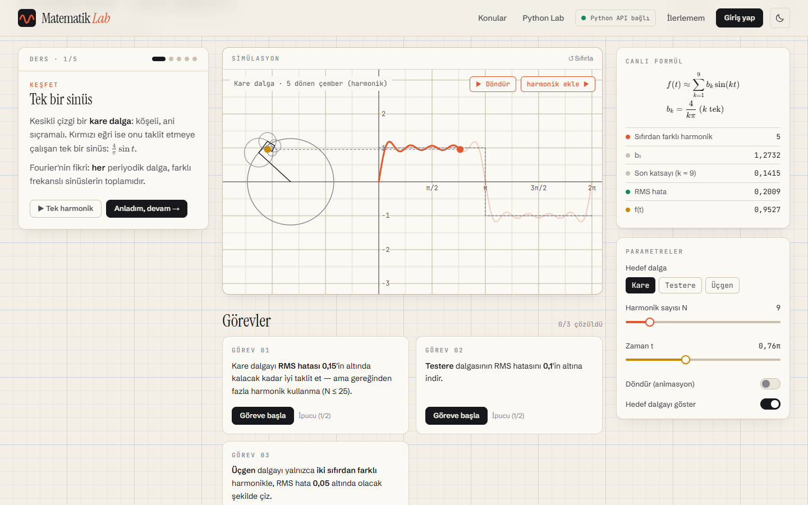<br/><sub><b>Fourier serileri.</b> Dönen çemberler kare dalgayı çizer.</sub></td>
  </tr>
  <tr>
    <td>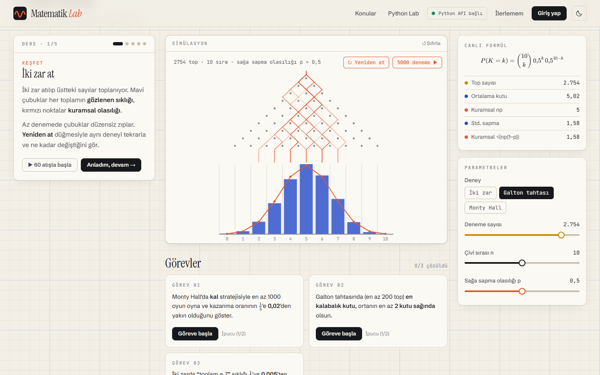<br/><sub><b>Olasılık.</b> Galton tahtası ve kuramsal binom dağılımı. Tüm deneyler tohumlu ve tekrarlanabilir.</sub></td>
    <td>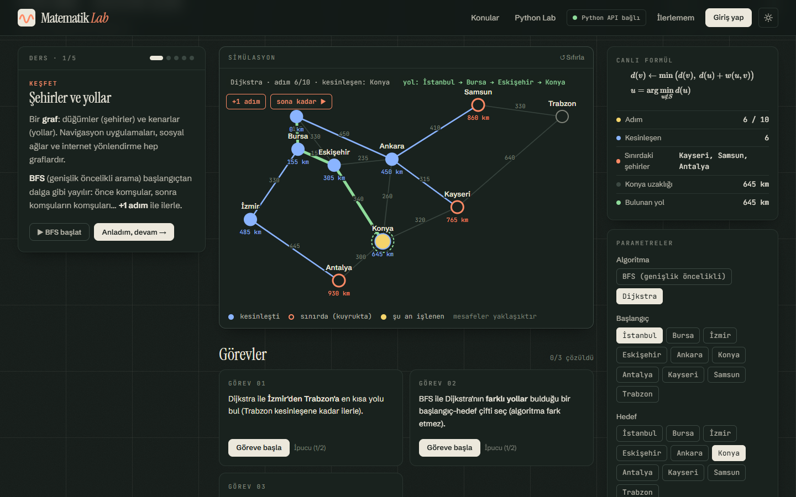<br/><sub><b>Graf teorisi.</b> Türkiye şehirleri üzerinde adım adım Dijkstra ve BFS.</sub></td>
  </tr>
  <tr>
    <td>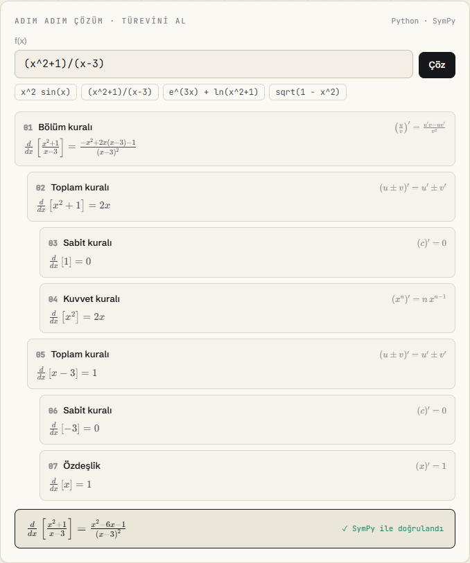<br/><sub><b>Adım adım çözüm (SymPy).</b> Kural ağacı ve doğrulanmış sonuç.</sub></td>
    <td>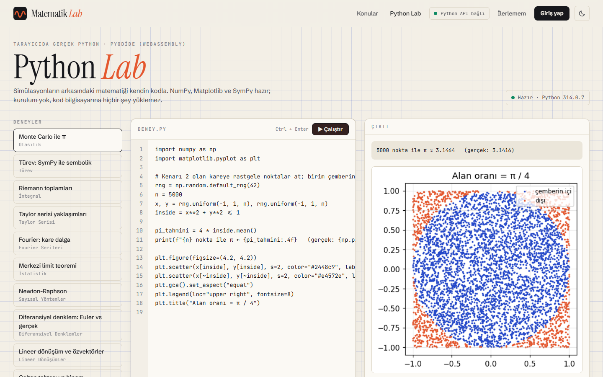<br/><sub><b>Python Lab.</b> Tarayıcıda çalışan Python ile Monte Carlo yöntemiyle π.</sub></td>
  </tr>
  <tr>
    <td>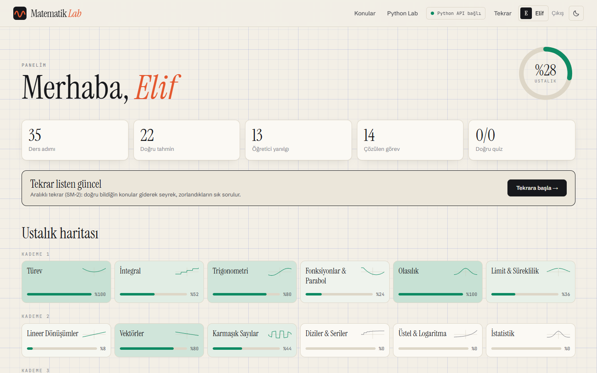<br/><sub><b>Panel.</b> Ustalık haritası, istatistikler, rozetler ve tekrar kuyruğu.</sub></td>
    <td>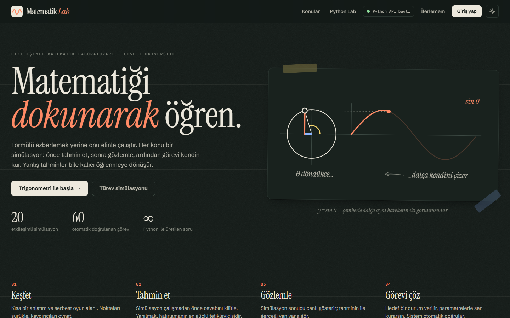<br/><sub><b>Kara Tahta teması.</b></sub></td>
  </tr>
  <tr>
    <td>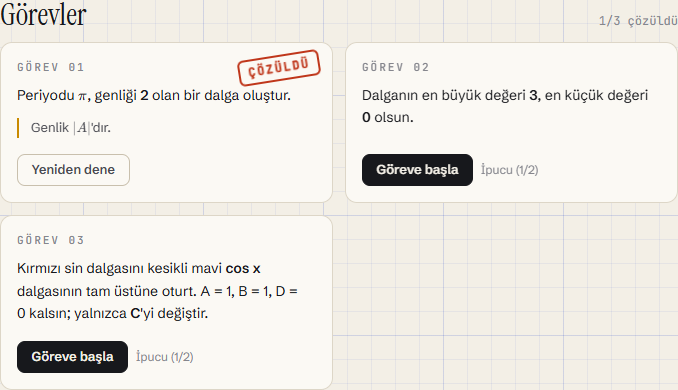<br/><sub><b>Görevler.</b> Otomatik doğrulama ve "ÇÖZÜLDÜ" damgası.</sub></td>
    <td align="center">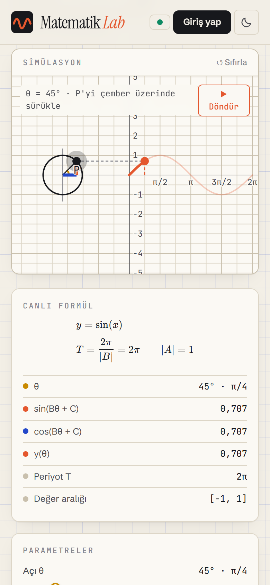<br/><sub><b>Mobil.</b></sub></td>
  </tr>
</table>

## 20 konu

Konular talebe göre sıralandı: YKS'deki soru ağırlığı ve öğrencilerin en çok zorlandığı üniversite dersleri (Calculus, Lineer Cebir, Olasılık) önce gelir.

| Kademe | Konu | Simülasyonda ne var? |
|---|---|---|
| **1** | Türev | Kesen → teğet limiti, eşzamanlı f′(x) grafiği |
| | İntegral | Sol/sağ/orta/yamuk Riemann toplamları, log ölçekli hata grafiği, işaretli alan |
| | Trigonometri | Birim çember ↔ sinüs dalgası, A·sin(Bx + C) + D |
| | Fonksiyonlar & Parabol | Öteleme/yansıma/ölçekleme, sürüklenebilir tepe noktası, diskriminant |
| | Olasılık | İki zar, Galton tahtası, Monty Hall; büyük sayılar yasası |
| | Limit & Süreklilik | ε–δ bantları, kaldırılabilir süreksizlik, sıçrama |
| **2** | Lineer Dönüşümler | Izgara bükme, determinant = alan, özvektörler |
| | Vektörler | Toplama, izdüşüm, vektörel çarpım = paralelkenar alanı |
| | Karmaşık Sayılar | Çarpma = döndürme, De Moivre, n. kökler |
| | Diziler & Seriler | Kısmi toplamlar, harmonik seri, Basel problemi |
| | Üstel & Logaritma | Bileşik/sürekli faiz, yarı ömür, log ölçek |
| | İstatistik | Merkezi limit teoremi, σ/√n |
| **3** | Taylor Serisi | Terim ekleyerek yaklaşım, yakınsaklık yarıçapı |
| | Fourier Serileri | Dönen çemberler, Gibbs olayı |
| | Diferansiyel Denklemler | Yön alanı, Euler ve RK4, SIR salgını, av-avcı |
| | Çok Değişkenli Calculus | 3B yüzey, gradyan, gradient descent |
| | Konikler | Odaklar, doğrultman, parabolün yansıma özelliği |
| | Sayısal Yöntemler | Newton-Raphson ile ikiye bölme yarışı |
| **Bonus** | Regresyon | Sürüklenebilir noktalar, artıkların kareleri |
| | Graf Teorisi | BFS ve Dijkstra |

## Mimari

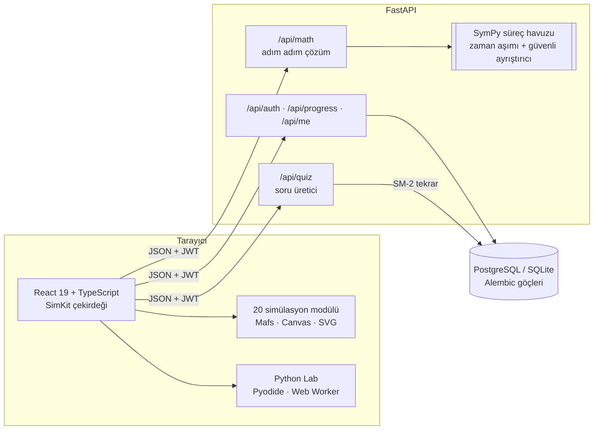

**Simülasyon eklenti sistemi.** Her konu tek bir `SimulationModule` nesnesidir: parametre şeması (sağ panel bundan otomatik oluşur), çizim bileşeni, ders adımları, görevler (`check(params) => boolean`), canlı formül ve ölçümler. Yeni bir konu eklemek çekirdeğe dokunmayı gerektirmez.

**Saf ve tekrarlanabilir modeller.** Rastgele deneyler (zar, Galton, Monty Hall, örneklem ortalamaları) `(tohum, deneme sayısı)` çiftinin saf fonksiyonudur. Bu sayede animasyonlar, görev denetimleri ve testler aynı sonucu verir.

## Teknoloji yığını

| Katman | Teknolojiler |
|---|---|
| Arayüz | React 19, TypeScript 5.9, Vite 8, Tailwind CSS 4, Zustand, React Router |
| Görselleştirme | Mafs (etkileşimli 2B), Canvas 2D (3B yüzey, Galton), SVG grafikler, KaTeX |
| Tarayıcıda Python | Pyodide 314 (CPython 3.14 / WebAssembly), NumPy, Matplotlib |
| Backend | FastAPI, Pydantic 2, SQLAlchemy 2, Alembic, SymPy, PyJWT, pwdlib (Argon2), slowapi |
| Veri | PostgreSQL 16 (Docker) · SQLite (geliştirme) |
| Test | Vitest, pytest, Playwright |
| Dağıtım | Docker Compose (PostgreSQL + FastAPI + nginx), GitHub Actions |

## Hızlı başlangıç

### Geliştirme

Gereksinimler: Node.js 22+ ve Python 3.12+.

```bash
# Backend: http://localhost:8000/api/docs
cd backend
python -m venv .venv
.venv/Scripts/pip install -r requirements-dev.txt   # macOS/Linux: .venv/bin/pip
.venv/Scripts/python -m uvicorn app.main:app --port 8000
```

```bash
# Frontend: http://localhost:5173
cd frontend
npm install
npm run dev
```

Veritabanı göçleri backend açılırken otomatik uygulanır (`MATLAB_AUTO_MIGRATE`). Backend kapalıyken de simülasyonlar çalışır; üst çubuktaki gösterge API durumunu gösterir.

### Docker (üretime benzer ortam)

```bash
cp .env.example .env     # MATLAB_SECRET_KEY değerini değiştir
docker compose up --build
```

Uygulama `http://localhost:8080` adresinde açılır. nginx statik dosyaları sunar ve `/api` isteklerini FastAPI'ye yönlendirir; veriler PostgreSQL'de tutulur.

## Testler

| Paket | Komut | Kapsam |
|---|---|---|
| Backend · **133 test** | `cd backend && pytest -q` | Güvenli ayrıştırıcı (kötü niyetli girdiler), türev/integral/limit doğruluğu, süreç havuzu zaman aşımı, 20 soru üreticisi, SM-2, hesaplar, belirteç yenileme, ilerleme birleştirme, rozetler, KVKK silme |
| Frontend birim · **97 test** | `cd frontend && npm test` | Tüm simülasyon modellerinin matematiği (Riemann kapalı formları, De Moivre, Gibbs, RK4, Dijkstra…) ve görevlerin çözülebilirliği |
| Uçtan uca · **31 test** | `cd frontend && npm run e2e` | 20 sayfanın hatasız açılması, tahmin akışı, görev doğrulama, SymPy çözümü, quiz, kayıt → panel → çıkış, tema, tarayıcıda Python çalıştırma |

> Windows'ta Playwright kurulu Edge ile çalıştırılabilir: `PW_CHANNEL=msedge npm run e2e`

README görüntüleri yeniden üretilebilir: `npm run screenshots` (backend ve frontend çalışırken).

## Proje yapısı

```
├─ frontend/
│  ├─ src/core/            # SimKit: tipler, parametre paneli, ders/görev motoru, grafikler, matematik
│  ├─ src/simulations/     # 20 konu: <konu>/{model.ts, Simulation.tsx, index.ts, model.test.ts}
│  ├─ src/features/        # api, auth, progress (senkron), quiz, solver, python-lab, toast, theme
│  ├─ src/pages/           # ana sayfa, simülasyon, panel, tekrar, Python Lab, giriş/kayıt, KVKK
│  ├─ public/pyodide-worker.mjs
│  └─ e2e/                 # Playwright testleri
├─ backend/
│  ├─ app/api/             # health, math, quiz, auth, progress, me
│  ├─ app/services/        # symbolic (parser, türev, integral, limit, sandbox), quiz, srs, progress
│  ├─ alembic/             # veritabanı göçleri
│  └─ tests/
├─ docs/screenshots/
└─ docker-compose.yml
```

## Yeni simülasyon eklemek

1. `frontend/src/simulations/<konu-id>/` altında bir `SimulationModule` yaz (örnek olarak `trig-unit-circle/` iyi bir başlangıç).
2. Matematiği `model.ts` içinde saf fonksiyonlar olarak tut ve `model.test.ts` ile test et. Görevlerin gerçekten çözülebildiğini de test et.
3. `catalog.ts` içindeki girdiye `load: () => import('./<konu-id>')` ekle.
4. Soru üretmek için `backend/app/services/quiz/generators.py` dosyasına `@generator("<konu-id>")` ekle.

## Güvenlik ve gizlilik

- Kullanıcı ifadeleri **asla serbestçe `eval` edilmez**. Kendi tokenizer'ımız yalnızca sayılara, `x`'e, izinli fonksiyonlara ve `+ - * / ^ ( )` karakterlerine izin verir. SymPy ayrı bir süreç havuzunda zaman aşımıyla çalışır; takılan hesaplama sonlandırılır.
- Parolalar Argon2id ile özetlenir. Erişim belirteci 15 dakika geçerlidir ve bellekte tutulur. Yenileme belirteci httpOnly çerezde saklanır, tek kullanımlıktır (rotation) ve çıkışta iptal edilir.
- Giriş, kayıt ve hesaplama uç noktalarında oran sınırlama vardır.
- KVKK: minimum veri (e-posta yok), açık rıza, tek tıkla kalıcı silme. `/kvkk` sayfasındaki metin bir şablondur; yayına alan kurum kendi bilgileriyle güncellemelidir.

## Yol haritası

- [x] Faz 0–1: Altyapı, SimKit, ilk iki simülasyon
- [x] Faz 2: Kademe 1, SymPy ile adım adım çözüm, soru üretici
- [x] Faz 3: Hesaplar, PostgreSQL, ilerleme senkronu, rozetler, SM-2, Docker
- [x] Faz 4: Kademe 2 ve Python Lab
- [x] Faz 5: Kademe 3 (3B dahil) ve bonus konular
- [x] Faz 6: E2E testleri, CI, dokümantasyon
- [ ] Öğretmen paneli: sınıf oluşturma ve öğrenci ilerlemesini izleme
- [ ] İngilizce arayüz (i18n)
- [ ] Kullanıcının kendi fonksiyonunu yazabildiği simülasyonlar (güvenli ifade ayrıştırıcıyla)
